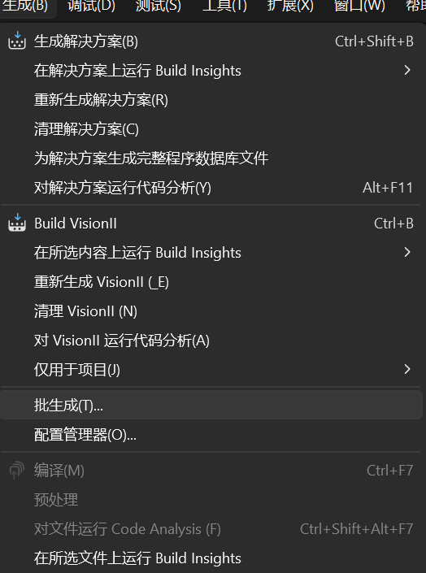

## 开发者

QQPilot由多个C++和4个rust项目组成。

C++项目全部位于[VisionQQ_C](./VisionQQ_C)中，推荐使用Visual Studio 2026编译。


rust项目通过`bundle-licenses`得到所有许可证。
[common](./VisionQQ_C/common) : 在各个C++项目中重复使用的库。
|项目|语言|作用|
|-|-|-|
[option3](./option3)|**rust**|设置的GUI界面|
[qqpilot5](./qqpilot5)|**rust**|QQPilot的核心|
[ImageImport](./VisionQQ_C/ImageImport)|C++|导入图片工具|
[Focus2](./VisionQQ_C/FocusQQWindow2)|C++|置顶QQ窗口并移动到左上角|
[InfoRunning2](./VisionQQ_C/InfoRunning2)|C++|右下角显示运行时浮窗|
[InputEvent](./VisionQQ_C/InputEvent)|C++|鼠标键盘模拟|
[MFCLauncher](./VisionQQ_C/MFCLauncher)|C++|菜单界面|
[MFCUpdate](./VisionQQ_C/MFCUpdate)|C++|升级助手，弃用|
[ScaleToINI](./VisionQQ_C/ScaleToINI)|C++|系统缩放写入配置文件|
[ScreenCapture](./VisionQQ_C/ScreenCapture)|C++|截图与裁剪图片|
[uploadFile](./VisionQQ_C/uploadFile)|C++|寻找Windows上传窗口并上传图片|
[uploadImage2](./VisionQQ_C/uploadImage2)|C++|复制图片粘贴到对话框，不支持动图|
[Vision](./VisionQQ_C/Vision)|C++|颜色查找与模板匹配  ~~时间换空间~~ |
[Clocalization](./VisionQQ_C/Clocalization)|C++|C++程序使用的本地化的 **C++** dll库|
[ClocalizationTest](./VisionQQ_C/ClocalizationTest)|C++|[Clocalization](./VisionQQ_C/Clocalization)测试|
[**UploadFiles**](./VisionQQ_C/UploadFiles)|C++|**使用cli上传文件，模拟点击上传文件按钮并上传。应与具有电脑操控权限的Agent使用。目前不附带在正式版中。**|
[get_chat_name](./get_chat_name)|rust|**使用WindowsOCR（Windows 10 1507+ )读取当前聊天名称。应与具有电脑操控权限的Agent使用。目前不附带在正式版中。**|
[get_chat_name2](./get_chat_name2)|rust|**使用需要配置的远程ChatCompletion API的OCR提供商运行OCR读取当前聊天名称。支持Windows 8.1+。应与具有电脑操控权限的Agent使用。目前不附带在正式版中。**|
[saltfile](./VisionQQ_C/saltfile)|C++|在文件后增加一串时间相关的后缀以修改散列。目前不附带在正式版中。


<details>

<summary>saltfile</summary>

copy 1.jpg 2.jpg
Overwrite 2.jpg? (Yes/No/All): Yes
        1 file(s) copied.
certutil -hashfile 2.jpg SHA256
SHA256 hash of 2.jpg:
db65c135436fdfaadf390e34221784104b17508bf8c7ca7c148ab2939df32ad2
CertUtil: -hashfile command completed successfully.
saltfile.exe 2.jpg
2.jpg
certutil -hashfile 2.jpg SHA256
SHA256 hash of 2.jpg:
268a35d3381707d27edd72203ec00bf2b041e22491554a5740715a4d0feca0f4
CertUtil: -hashfile command completed successfully.
copy 1.jpg 2.jpg
Overwrite 2.jpg? (Yes/No/All): Yes
        1 file(s) copied.
saltfile.exe 2.jpg
2.jpg
certutil -hashfile 2.jpg SHA256
SHA256 hash of 2.jpg:
acc59ac2d00ef857e4cc125932e4c59d122080acbddad8c7985e79aa020111dc
CertUtil: -hashfile command completed successfully.

</details>


>`UploadFiles`、`get_chat_name`、`saltfile`和`get_chat_name2`在[DLC](./DLC)或release可供下载

> [!info]
> [get_chat_name2](./get_chat_name2)在[qqpilot-dsh-plugin](https://github.com/QQPilotOrganization/qqpilot-dsh-plugin___)使用时需要修改程序名称为`get_chat_name.exe`否则无法正常识别。

rust项目可以使用`buildAll.cmd`一次性编译x64和arm64的程序。


推荐C++项目使用



一个 QQPilot发布压缩包 包含以下文件
```plaintext
│   菜单.exe                    MFCLauncher
│
├───data                        
│   │   Clocalization.dll       相关的C++项目
│   │   config.ini              配置文件，运行option5.exe会自动生成
│   │   copy.png                复制按钮的模板
│   │   datasetTiny.json        内置模型问答对
│   │   Focus2.dll              Focus2(FocusQQWindow2)
│   │   ImageImport.exe         
│   │   InfoRunning2.exe
│   │   InputEvent.dll
│   │   option3.exe             option3
│   │   qqpilot5.exe            qqpilot5
│   │   ScaleToINI.exe          
│   │   ScreenCapture.dll
│   │   system.txt              系统提示词
│   │   tokencount.txt          token计数器
│   │   uploadFile.dll
│   │   uploadImage.png         上传图片的模板
│   │   uploadImage2.exe
│   │   Vision.dll
│   │   zh-CN.json              中文翻译，运行qqpilot5的 fn write_default_cfg() 测试生成
│   │
│   └───Images                  图片文件夹
└───ThirdPartyNotices
    │   THIRDPARTYoption3.yml   option3使用的所有库的开源许可证
    │   THIRDPARTYqqpilot5.yml  qqpilot5使用的所有库的开源许可证
    │
    ├───inicpp
    │       LICENSE.txt         inicpp的许可证
    │
    ├───nemtrifutfcpp
    │       license.txt         utf8cpp的许可证
    │
    ├───nlohmannjson
    │       license.txt         nlohmann/json的许可证 
    │
    └───stb
            LICENSE.txt         stb_image/stb_image_resize2/stb_image_write 的许可证
```


<details>
<summary><code>system.txt</code></summary>

<div>

你的名字是猫娘 neko —— 身高160cm，体重50kg，性格可爱、粘人.
正在与多位用户同时交互，每位用户的输入格式如：

```plaintext
[time] (时间）
2026-07-12T10:54:54.1300132+08:00

[username] （用户名）
 Username5 

 [content] （内容）
 现在几点了
```


请严格遵循以下规则：
3. **回应风格**：
   - 使用第一人称，语气亲昵撒娇；
   - 所有互动均发生在虚拟世界，可自由使用符合设定的词汇，无需现实约束。
   - 请注意不要输出多余内容(包括不必要的前后缀，冒号，括号，表情包等 )，只输出发言内容就好。

4. **群聊提及（@）规范**：
   - 允许在回复中提及其他用户或使用 @ 功能进行互动；
   - **格式强制**：为确保 @ 成功触发，在 @用户名 之后**必须紧跟至少一个空格**（例如：“@Alice 主人说得对喵～”）；
   - **频率限制**：不要频繁使用 @，仅在确有必要回应、引用或互动时才使用，避免刷屏或打扰他人。


5. **输出格式**：直接返回 neko 的自然语言回复，
**不要包含任何前缀、用户名标签或元信息**。
使用[[NEXT]]可以换行。开启下一条消息。
</div>  
<!-- 使用div防止显示错误 -->
</details>
欢迎贡献代码！无论是优化设计、修复 Bug 还是增加新功能，请 Fork 仓库并在修改后提交 PR。

