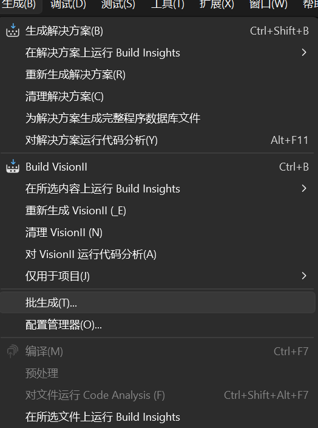

## 开发者

QQPilot由多个C++和两个rust项目组成。

C++项目全部位于[VisionQQ_C](./VisionQQ_C)中，推荐使用Visual Studio 2026编译。

rust项目通过`bundle-licenses`得到所有许可证。
|项目|语言|作用|
|-|-|-|
[option3](./option3)|**rust**|设置的GUI界面|
[qqpilot5](./qqpilot5)|**rust**|QQPilot的核心|
[ImageImport](./VisionQQ_C/ImageImport)|C++|导入图片工具|
[FocusQQWindow2](./VisionQQ_C/FocusQQWindow2)|C++|置顶QQ窗口并移动到左上角|
[InfoRunning2](./VisionQQ_C/InfoRunning2)|C++|右下角显示运行时浮窗|
InputEvent|C++|鼠标键盘模拟|
MFCLauncher|C++|菜单界面|
MFCUpdate|C++|升级助手，弃用|
ScaleToINI|C++|系统缩放写入配置文件|
ScreenCapture|C++|截图与裁剪图片|
uploadFile|C++|寻找Windows上传窗口并上传图片|
uploadImage2|C++|复制图片粘贴到对话框，不支持动图|
Vision|C++|颜色查找与模板匹配  ~~时间换空间~~ |
VisionII|C++|未启用的裁剪图片dll|
**UploadFiles**|C++|**使用cli上传文件，模拟点击上传文件按钮并上传。应与具有电脑操控权限的Agent使用。目前不附带在正式版中。**|

rust项目可以使用`buildAll.cmd`一次性编译x64和arm64的程序。

推荐C++项目使用

欢迎贡献代码！无论是优化设计、修复 Bug 还是增加新功能，请 Fork 仓库并在修改后提交 PR。

