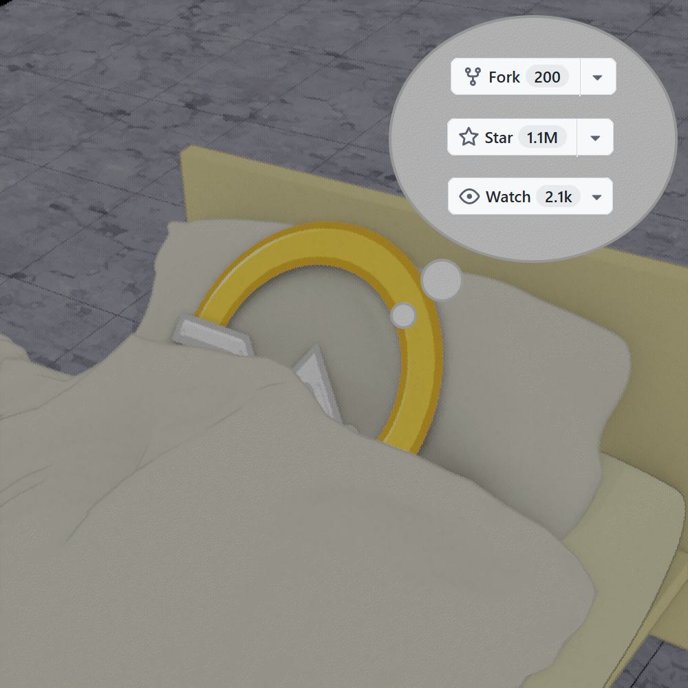

<h2> QQPilot</h2>

基于<i>窗口自动化</i>的 QQ 自动回复机器人

[Linux版本](https://github.com/QQPilotOrganization/QQPilotLinux) [Gitee](https://gitee.com/Na2Cr2O7/QQPilotLinux) | [Android](https://github.com/QQPilotOrganization/QQPilotPocketEdition)

> 使用纯视觉 + 窗口自动化实现 QQ 消息自动回复，**零 API 依赖、零注入、低封号风险**。  

###  项目简介

* QQPilot 是一个全自动的 QQ 聊天机器人，通过以下流程实现智能回复：

> 复制聊天内容 → 解析消息（含图片/表情包）→ 调用 LLM 生成回复 → 模拟输入并发送

全程 **不调用 QQ 内部接口、不 Hook 进程、不注入 DLL**，极大降低账号封禁风险。

## 核心优势

- **极致安全**：纯视觉操作，零注入、零 Hook，几乎无封号风险，不会自动掉线
- **部署简单**: 直连AI API提供商和内置模型，无需[Astrbot](https://astrbot.app/)等Agent就可以正常使用。
- **端侧模型兼容**: 没有任何工具调用和上下文注入，图片输入可选，最早可支持`qwen:0.5b`。
- **隐私**：支持完全本地运行，数据不出设备  
- **灵活**：可对接任意Open AI API本地大模型（如 Ollama / Llama.cpp）或远程 HTTP API  

[安装](documentation/install.md)

[各配置项用法](documentation/options.md)

[配置要求](documentation/requirements.md)

[工作原理](documentation/工作原理.md)

[不同平台的版本差异](documentation/diff.md)

[内置模型](documentation/TinyLangJaccardReadme.md)

[开发者](documentation/compile.md)

[插件](documentation/ext.md)

## 🛡️ 免责声明

本软件 **仅限技术学习与研究用途**，严禁用于：
- 自动骚扰、刷屏、诈骗等恶意行为  
- 违反《QQ 软件许可协议》的操作  
- 任何违法违规场景

使用者须自行承担因使用本软件引发的一切法律责任，作者概不负责。

如遇问题，欢迎提交 Issue。

本项目采用 [The Unlicense](LICENSE)

